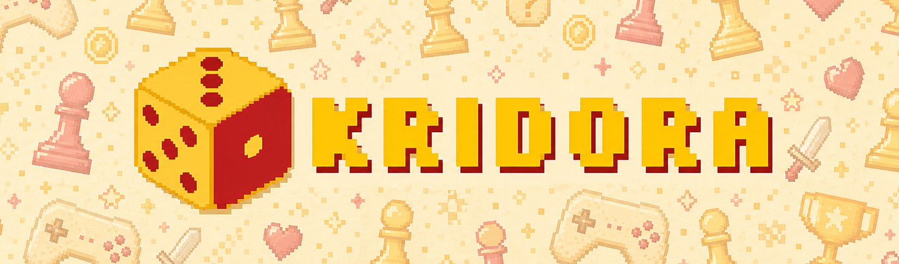
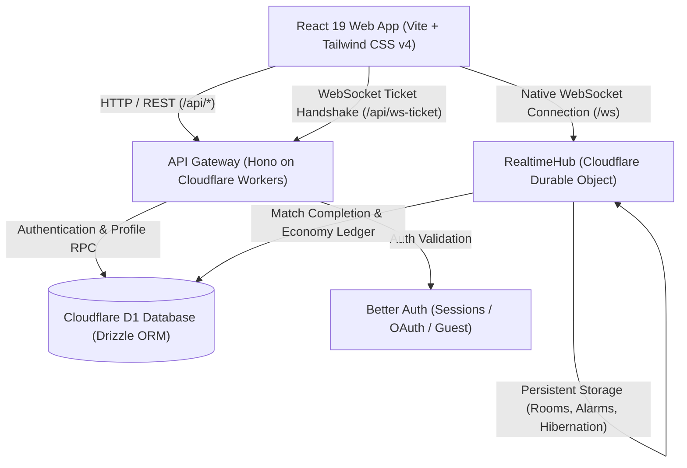
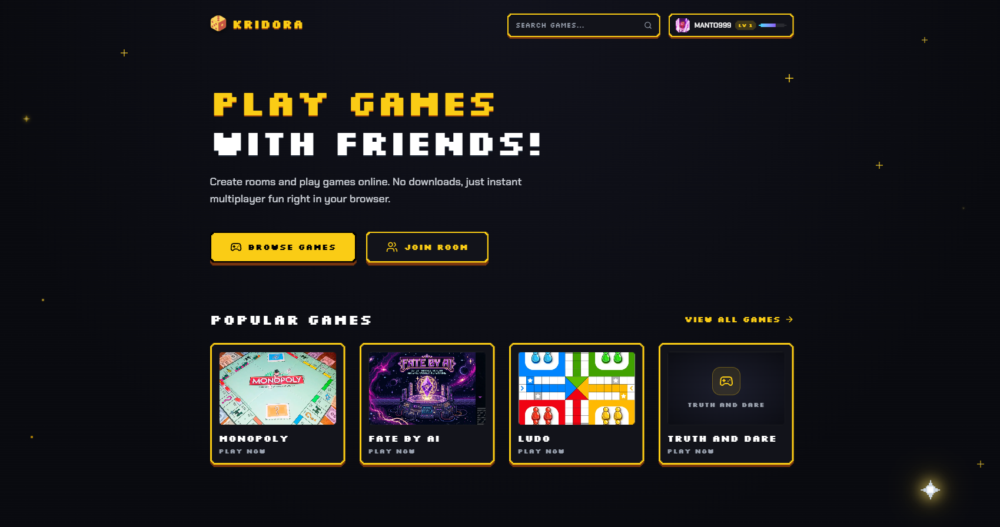
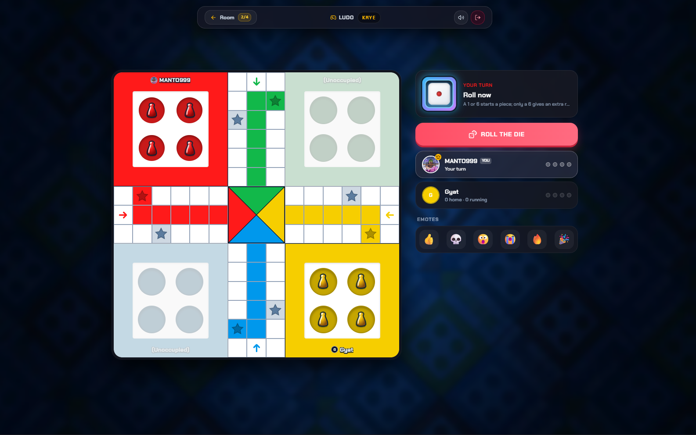

  

  
  
  
  
  
  
  
  
  
  
  
  

---

## About

Kridora is an open-source, edge-native multiplayer party game platform engineered for ultra-low latency, instant matchmaking, and seamless real-time web gaming. Built on Cloudflare Workers and Durable Objects with WebSocket Hibernation, Kridora delivers sub-millisecond room synchronization and scalable game lobbies without dedicated game server hosting costs.

> **Try It Out:** [kridora.org](https://kridora.org)

### What's inside

Kridora is arranged as a Turborepo monorepo:

- **`apps/web`**: The React 19 single-page application built with Vite, Tailwind CSS v4, Lucide icons, and Framer Motion, hosting responsive game boards, dynamic lobbies, and audio-reactive HUDs.
- **`apps/api`**: The Hono API and Cloudflare Workers gateway managing Better Auth sessions, HMAC WebSocket upgrade tickets, and real-time room coordination via Cloudflare Durable Objects (`RealtimeHub`).
- **`packages/db`**: Drizzle ORM schema definitions, SQLite migrations for Cloudflare D1, and the atomic ledger service for the Rings economy.
- **`packages/shared`**: Shared TypeScript types, Zod schemas, WebSocket event contracts, room state machine definitions, and game rule modules.
- **`packages/typescript-config`**: Centralized TypeScript configuration presets for DOM, Node, and Cloudflare Workers runtimes.

---

## Architecture Overview

### Highlights

- **Edge-First Realtime Engine**: Native WebSockets managed by Cloudflare Durable Objects using the **WebSocket Hibernation API**, eliminating idle CPU costs while delivering sub-millisecond room coordination.
- **HMAC WebSocket Upgrade Tickets**: Single-use, time-bound (30s) cryptographically signed upgrade tokens eliminate connection replay attacks and cross-origin authentication issues.
- **Robust Session & Guest System**: Powered by [Better Auth](https://www.better-auth.com/) with instant, passwordless guest onboarding, email verification, password reset flows, and Google OAuth.
- **Append-Only Economy Ledger**: Rings game currency is strictly managed through row-locked, atomic, idempotent transactions with cryptographic idempotency keys.
- **State-Driven Matchmaking & Room Management**: Zero room code exposure in browser URLs. Instant rejoining upon reconnect, automatic host succession for disconnected room owners, and alarm-driven stale room garbage collection.
- **Type-Safe Monorepo**: 100% end-to-end type safety across client events, server actions, database models, and shared game definitions via Turborepo and TypeScript.

## Screenshots

---

## Getting Started

To install Kridora and run it on your computer, check out our step-by-step setup guide:

👉 **[Read the Usage Guide (docs/USAGE.md)](docs/USAGE.md)**

### App Guides

- **Web Frontend**: [apps/web README](apps/web/README.md)
- **API Backend**: `apps/api` does not have its own README yet. Everything you need to run it is covered in the [Usage Guide](docs/USAGE.md).
- **Database & Shared Packages**: Handled via Turborepo workspaces and detailed in the [Usage Guide](docs/USAGE.md).

---

## Adding a Game

Kridora makes it easy to add new party games and real-time board activities through self-contained game modules.

👉 **[Read the Game Developer Guide (docs/ADDING_A_GAME.md)](docs/ADDING_A_GAME.md)**

---

## Contributing

We welcome contributions of all kinds, including bug fixes, new game modes, UI polish, and documentation!

Please read our **[Contributing Guide (docs/CONTRIBUTING.md)](docs/CONTRIBUTING.md)** to learn how to set up your environment, follow our architectural rules, and open a pull request.

---

## Support

If you find Kridora helpful or exciting, please consider giving this repository a star ⭐ on GitHub!

- Follow updates on X: [@subhajeetch](https://x.com/subhajeetch)
- Join our community on Discord: [Join Chat](https://discord.com/invite/6DhssCN2Ph)

---

## License

Kridora is free and open-source software released under the [Apache 2.0 License](LICENSE).
