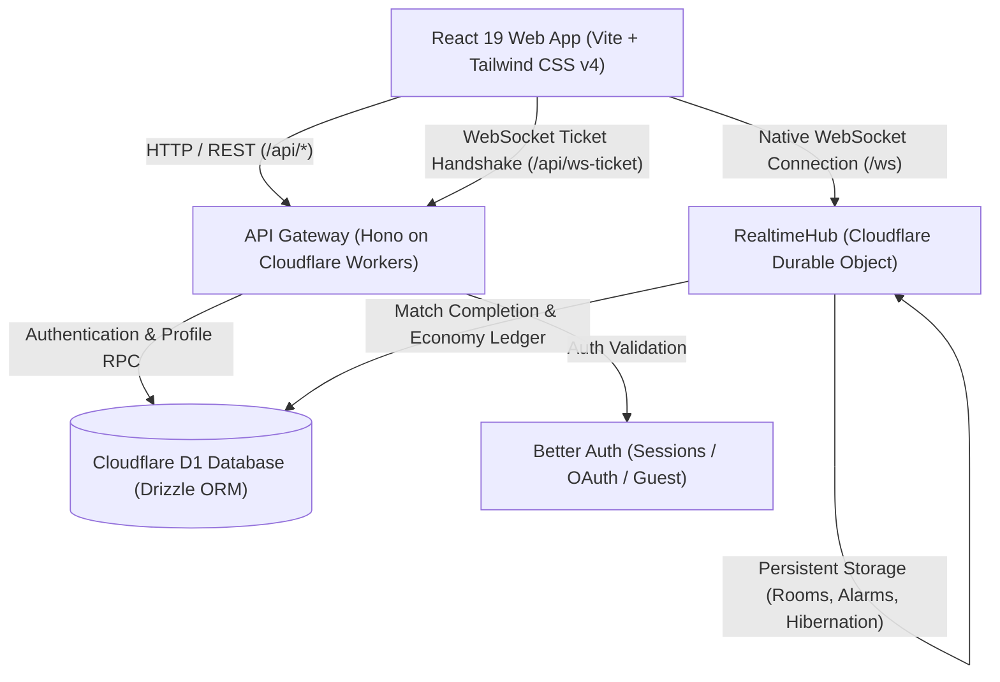

# Kridora

Modern real-time multiplayer gaming platform built for ultra-low latency, seamless room matchmaking, and edge-native scalability. Powered by **Cloudflare Workers**, **Hono**, **Cloudflare Durable Objects**, **React**, and **Cloudflare D1 (Drizzle ORM)**.

---

## Architecture Overview



### Highlights

- **Edge-First Realtime Engine**: Native WebSockets managed by Cloudflare Durable Objects using the **WebSocket Hibernation API**, eliminating idle CPU costs while delivering sub-millisecond room coordination.
- **HMAC WebSocket Upgrade Tickets**: Single-use, time-bound (30s) cryptographically signed upgrade tokens eliminate connection replay attacks and cross-origin authentication issues.
- **Robust Session & Guest System**: Powered by [Better Auth](https://www.better-auth.com/) with instant, passwordless guest onboarding, email verification, password reset flows, and Google OAuth.
- **Append-Only Economy Ledger**: Rings game currency is strictly managed through row-locked, atomic, idempotent transactions with cryptographic idempotency keys.
- **State-Driven Matchmaking & Room Management**: Zero room code exposure in browser URLs. Instant rejoining upon reconnect, automatic host succession for disconnected room owners, and alarm-driven stale room garbage collection.
- **Type-Safe Monorepo**: 100% end-to-end type safety across client events, server actions, database models, and shared game definitions via Turborepo and TypeScript.

---

## Monorepo Structure

```
kridora/
├── apps/
│   ├── api/                 # Cloudflare Worker API (Hono + Durable Objects RealtimeHub)
│   └── web/                 # Single-page application (React 19, Vite, Tailwind CSS v4)
└── packages/
    ├── db/                  # Drizzle ORM schemas, D1 migrations, Rings ledger service
    ├── shared/              # Shared types, Zod schemas, socket contracts, game definitions
    └── typescript-config/   # Shared tsconfig bases for Node, DOM, and Workers
```

---

## Quickstart

### Prerequisites

- **Node.js**: `v24` or later
- **pnpm**: `v11` or later
- **Wrangler**: Cloudflare Workers CLI (bundled via devDependencies)

### 1. Clone & Install Dependencies

```bash
git clone https://github.com/your-username/kridora.git
cd kridora
pnpm install
```

### 2. Configure Environment

Copy the environment templates:

```bash
# Root environment configuration
cp .env.example .env

# API Worker configuration (wrangler dev secrets)
cp apps/api/.dev.vars.example apps/api/.dev.vars
```

Generate a secure 32-byte secret for `BETTER_AUTH_SECRET`:

```bash
openssl rand -base64 32
```

Paste this secret into both `.env` and `apps/api/.dev.vars`.

### 3. Run Local D1 Migrations

Apply the database schema to your local Cloudflare D1 database:

```bash
pnpm db:migrate
```

### 4. Launch Development Servers

Start both the Web frontend and Cloudflare Workers API concurrently:

```bash
pnpm dev
```

- **Frontend**: [http://localhost:5173](http://localhost:5173)
- **API Worker**: [http://localhost:2020](http://localhost:2020)

In local development, the Vite server automatically proxies `/api` and `/ws` to the local Worker on port 2020.

---

## Available Scripts

| Command                | Description                                                       |
| :--------------------- | :---------------------------------------------------------------- |
| `pnpm dev`             | Starts Vite dev server and Wrangler local dev server concurrently |
| `pnpm build`           | Builds production bundles for the web app and API worker dry-run  |
| `pnpm check-types`     | Type-checks all packages and applications across the monorepo     |
| `pnpm lint`            | Runs linter across applications                                   |
| `pnpm format`          | Formats codebase with Prettier                                    |
| `pnpm db:generate`     | Generates new SQL migration files after schema edits              |
| `pnpm db:migrate`      | Applies pending Drizzle migrations to local Cloudflare D1         |
| `pnpm db:migrate:remote` | Applies pending Drizzle migrations to production Cloudflare D1  |
| `pnpm db:studio`       | Opens Drizzle Studio database visualizer in your browser          |

---

## Real-Time Architecture & Durable Objects

### Connection Lifecycle

1. **Authentication Handshake**: When an authenticated or guest player initiates a WebSocket connection, the client issues a `POST /api/ws-ticket` request with their session cookie.
2. **HMAC Ticket Generation**: The API verifies the session and signs an HMAC-SHA256 ticket containing the player's identity, timestamp expiration (30 seconds), and a cryptographic single-use nonce.
3. **Upgrade Request**: The client connects to `GET /ws?ticket=<token>`. The Worker verifies the signature, validates and marks the single-use nonce inside the Durable Object (`RealtimeHub`), and upgrades the socket via `101 Switching Protocols`.
4. **WebSocket Hibernation**: The Durable Object accepts the connection using `ctx.acceptWebSocket(server)`. Sockets sleep when idle and automatically wake on incoming messages or heartbeats (`ping`/`pong`).

### Room Management

- **Lobby Phase**: Players can ready up, invite others by numeric Player ID or encrypted share links, switch room visibility (public/private), or change the active game without leaving the room.
- **Match In-Progress**: The room transitions to `in_progress`. Game state updates are coordinated exclusively through the game's registered module. Players can toggle between the active game view and the player roster.
- **Offline Resilience & Host Succession**: If the room host disconnects, a 40-second grace countdown begins. If the host does not return within the deadline, ownership transfers automatically to the next connected player.
- **Alarm-Driven Garbage Collection**: The Durable Object schedules system alarms to clean up empty or expired rooms, preventing memory leaks and orphaned sessions.

---

## Rings Economy & Game Currency

- **Atomic Ledger**: User ring balances in `player_profiles.rings_balance` represent the current balance, while `ring_transactions` provides an immutable, append-only history.
- **Strict Mutation APIs**: Balances must **only** be modified using `grantRings`, `spendRings`, or `applyRingTransaction` from `@kridora/db`. Direct SQL `UPDATE` statements are strictly prohibited.
- **Idempotency Guarantee**: Every economy transaction requires an `idempotencyKey` to prevent double-crediting during network retries or concurrent calls.

---

## Adding a New Game

To create a new game module for the platform:

1. **Define Game Metadata & Rules** in `packages/shared/src/games/`:
   - Create game definition conforming to `GameDefinition`.
   - Register the game slug in `packages/shared/src/games/registry.ts`.
2. **Implement Server-Side State Machine** in `apps/api/src/games/`:
   - Implement `ServerGameModule<TState, TAction, TOutcome>`.
   - Implement `createInitialState`, `handleAction`, and optional state masking via `serializeStateForPlayer`.
3. **Implement Client-Side Game Component** in `apps/web/src/games/`:
   - Build the interactive game board utilizing `request(...)` and socket events.
   - Register the component in `apps/web/src/games/registry.ts`.

---

## Production Deployment

### 1. Database (Cloudflare D1)

- Cloudflare D1 is a serverless SQL database natively integrated with Workers.
- Ensure your production D1 database is created and bound in `apps/api/wrangler.jsonc`:
  ```bash
  npx wrangler d1 create kridora
  ```
- Apply remote database migrations to production Cloudflare D1:
  ```bash
  pnpm db:migrate:remote
  ```

### 2. Deploy API Worker

```bash
# Deploy Cloudflare Worker & Durable Objects
pnpm --filter @kridora/api deploy
```

Set required secrets in Cloudflare Workers:

```bash
npx wrangler secret put BETTER_AUTH_SECRET
```

### 3. Deploy Web Frontend

The frontend in `apps/web` builds to static assets (`apps/web/dist`) and can be hosted on **Cloudflare Pages**, **Vercel**, or any CDN:

```bash
pnpm --filter web build
```

Configure `VITE_API_URL` to point to your deployed API domain (e.g. `https://api.kridora.org`).

---

## License

Private and proprietary. All rights reserved.
