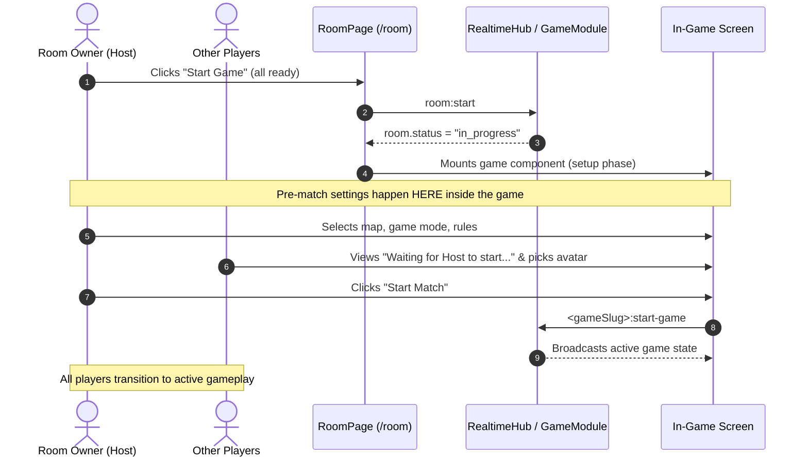

# Adding a Game to Kridora

Adding a game to Kridora requires creating self-contained modules for your game logic and client screen. The platform handles accounts, authentication, room codes, public matchmaking, ready-up states, host migration, start validation, and reconnects automatically.

---

## Strict Development Boundaries

Follow these core architecture rules when adding or modifying any game:

> [!IMPORTANT]
> **1. Never touch platform UI or room pages**
> - **Do NOT modify** `apps/web/src/pages/GameLobbyPage.tsx` (`/<gameSlug>`). The front door is generic and auto-generated from your game definition.
> - **Do NOT modify** `apps/web/src/pages/RoomPage.tsx` (`/<gameSlug>/room`). The room roster, invite links, ready toggles, and start validation are managed uniformly for all games.
> - **Do NOT modify** global layout components like `AppShell.tsx`, `PlayerHud.tsx`, or global CSS for game-specific styling.
> - All visuals, game audio, board renders, HUDs, and pause menus **must live strictly inside your game's directory**: `apps/web/src/games/<slug>/`.

> [!IMPORTANT]
> **2. Pre-game settings belong inside the game after launch**
> - If your game requires pre-match configuration (e.g., selecting a map, game mode, round length, difficulty, age pack, or spinner):
>   - **Do NOT** inject settings into the lobby or room page.
>   - The room owner will configure them **inside the game screen AFTER entering the game** (i.e. once `room.status === "in_progress"`).
>   - **The Flow**:
>     1. Players ready up and the owner clicks **"Start Game"** on `RoomPage.tsx`.
>     2. The server transitions the room to `in_progress` and mounts your game component wrapped in `<InGameRoomProvider>`.
>     3. The game state begins in a `setup` phase.
>     4. **Room Owner (Host)**: Sees the configuration screen inside the game to select maps, rules, or settings, with a prominent **"Start Game"** / **"Begin Match"** button.
>     5. **Other Players**: See a waiting screen (e.g. *"Waiting for [Host] to start the game…"*) with a live preview of choices. Other players may pick personal options (such as character avatar, cosmetics, or color) while waiting.
>     6. Once the host clicks start, the state machine transitions to active gameplay for all connected players.



> [!WARNING]
> **3. Do not create unnecessary backend APIs or global hooks**
> - Do not add custom REST routes or modify `RealtimeHub.ts` or `room-manager.ts` for game-specific actions.
> - Modular game events (`<gameSlug>:*`) are dispatched directly to your `ServerGameModule` when `room.status === "in_progress"`.
> - Authoritative game state must remain on the server (`apps/api/src/games/<slug>.ts`). Never trust the client for dice rolls, card draws, money, or scores.

> [!TIP]
> **4. Third-party packages and dependencies**
> - It is completely fine to install new packages if your game requires them (e.g., 3D canvas renderers, physics engines, specialized math helpers).
> - **Security Requirement**: Any added dependency **must be popular, actively maintained, and verified safe without backdoors or unvetted scripts**. Avoid single-maintainer, unverified packages.

> [!CAUTION]
> **5. Never add your game to `config.production.ts`**
> - **NEVER** add your game slug to `packages/shared/src/games/config.production.ts`.
> - You should **ONLY** add your slug to `packages/shared/src/games/config.development.ts` while creating, developing, and testing your game.
> - If your game is thoroughly tested, polished, and ready for public release, **let the repository owner or ask an active maintainer** to review it and promote it to production. PRs that modify `config.production.ts` directly will not be accepted.

---

## Step-by-Step Implementation

### Step 1: Describe It — `packages/shared/src/games/registry.ts`

Add your game definition to `GAME_DEFINITIONS`. This object automatically configures the game card on `/games`, the front entrance on `/<gameSlug>`, and start requirements:

```ts
export const GAME_DEFINITIONS = {
  monopoly: {
    slug: "monopoly", // URL: yourdomain.com/monopoly
    name: "Monopoly",
    tagline: "Buy, trade and bankrupt your friends.",
    description: "Roll the dice, buy properties, build houses and drive rivals into bankruptcy.",
    accent: "#f43f5e",
    playTime: "60-120 min",
    minPlayers: 2,
    maxPlayers: 6,
    requirements: {
      allPlayersReady: true, // every non-owner must press "Ready"
      allPlayersConnected: true, // nobody may be offline when owner presses Start
    },
    genre: ["Economic Strategy", "Board Game", "Turn-Based"],
    difficulty: "Strategic",
    overview: [
      "Monopoly is the classic board game of property acquisition and financial trading.",
    ],
    howToPlay: [
      { step: 1, title: "Roll & Move", description: "Roll dice to travel around the board." },
      { step: 2, title: "Acquire Deeds", description: "Buy unowned properties you land on." },
    ],
    rulesSummary: [
      "Passing GO collects a recurring salary bonus.",
    ],
    controls: [
      { key: "Click / Tap", action: "Roll dice and select properties" },
    ],
  },
} satisfies Record<string, GameDefinition>;
```

### Step 2: Turn It On (Development Only) — `packages/shared/src/games/config.development.ts`

Add your slug **only** to `developmentGames` in `packages/shared/src/games/config.development.ts` to test and build it locally:

```ts
export const developmentGames: readonly GameSlug[] = [
  "monopoly",
  "ludo",
  "fatebyai",
  "truth-and-dare",
  // "your-game-slug",
];
```

> [!CAUTION]
> **Do NOT touch `config.production.ts`!** Never add your game directly to `packages/shared/src/games/config.production.ts`. When your game is completely finished, bug-free, and polished enough for players, let the repository owner or ask an active maintainer to add it to production.

### Step 3: Define Socket Events — `packages/shared/src/socket-events.ts`

Define Zod schemas and add event payloads to `ClientToServerEvents` and `ServerToClientEvents`:

```ts
// 1. Zod payload schemas
export const monopolyRollSchema = z.object({});
export const monopolyBuySchema = z.object({ propertyId: z.string() });

// 2. Types
export type MonopolyRollPayload = z.input<typeof monopolyRollSchema>;
export type MonopolyBuyPayload = z.input<typeof monopolyBuySchema>;

// 3. ClientToServerEvents
export interface ClientToServerEvents {
  // ...
  "monopoly:roll": (payload: EmptyPayload, ack: AckFn<MonopolyState>) => void;
  "monopoly:buy": (payload: MonopolyBuyPayload, ack: AckFn<MonopolyState>) => void;
}

// 4. ServerToClientEvents
export interface ServerToClientEvents {
  // ...
  "monopoly:state": (state: MonopolyState) => void;
}
```

### Step 4: Implement Server Module — `apps/api/src/games/<slug>.ts`

Implement `ServerGameModule<TState>` and register it in `apps/api/src/games/registry.ts`:

```ts
import type { ServerGameModule } from "./types";
import { ApiError } from "../lib/errors";

export const monopolyGameModule: ServerGameModule<MonopolyState> = {
  slug: "monopoly",
  eventPrefix: "monopoly",
  stateEvent: "monopoly:state",

  createInitialState(players) {
    return {
      players: players.map((p) => ({ userId: p.userId, name: p.name, balance: 1500 })),
      phase: "setup", // or "playing"
      turnIndex: 0,
      updatedAt: Date.now(),
    };
  },

  handleAction(ctx, action, rawPayload) {
    const { state, user } = ctx;

    switch (action) {
      case "get-state":
        return state;

      case "roll": {
        if (state.players[state.turnIndex]?.userId !== user.id) {
          throw new ApiError("FORBIDDEN", "Not your turn.");
        }
        // Authoritative server-side roll
        const die1 = Math.floor(Math.random() * 6) + 1;
        const die2 = Math.floor(Math.random() * 6) + 1;
        // Mutate state & broadcast
        state.updatedAt = Date.now();
        ctx.setState(state);
        ctx.broadcastState();
        return state;
      }

      default:
        throw new ApiError("VALIDATION_ERROR", `Unknown action: ${action}`);
    }
  },

  onPlayerLeft(state, userId) {
    // Handle player departure mid-match
    return true;
  },
};
```

Register it in `apps/api/src/games/registry.ts`:

```ts
export const SERVER_GAME_MODULES: Record<GameSlug, ServerGameModule<any>> = {
  monopoly: monopolyGameModule,
  // ...
};
```

### Step 5: Implement Client Component — `apps/web/src/games/<slug>/main.tsx`

Default-export a component that takes `GameComponentProps`:

```tsx
import type { GameComponentProps } from "../types";
import { useInGameRoom, useGameAudio } from "@/games/hooks";
import { request, socket } from "@/lib/socket";

export default function MonopolyGame({ room, userId }: GameComponentProps) {
  const { onBackToRoom, onLeaveRoom, isLeaving, roomCode, playerCount, maxPlayers, owner } = useInGameRoom();
  const { isMuted, toggleMute } = useGameAudio();
  const isHost = room.ownerId === userId || owner?.userId === userId;

  // 1. If in pre-game setup phase
  if (state?.phase === "setup") {
    return isHost ? (
      <HostSetupView onStartMatch={handleStartMatch} />
    ) : (
      <PlayerWaitingView hostName={owner?.name ?? "Host"} />
    );
  }

  // 2. Active Gameplay Screen
  return (
    <div className="flex h-full w-full flex-col items-center justify-between overflow-hidden">
      {/* Custom Game HUD */}
      <header className="flex w-full items-center justify-between p-3 border-b border-border/40">
        <button onClick={onBackToRoom} className="text-xs font-bold">
          ← Room ({playerCount}/{maxPlayers})
        </button>
        <span className="font-mono text-xs font-bold">ROOM {roomCode}</span>
        <button onClick={toggleMute} className="text-xs">
          {isMuted ? "Unmute" : "Mute"}
        </button>
      </header>

      {/* Game Arena */}
      <main className="flex-1 w-full">
        {/* Your game board goes here */}
      </main>
    </div>
  );
}
```

Register it in `apps/web/src/games/registry.ts`:

```ts
const gameLoaders: Record<GameSlug, GameLoader> = {
  monopoly: () => import("./monopoly/main"),
  // ...
};

export const gameComponents: Record<GameSlug, LazyExoticComponent<ComponentType<GameComponentProps>>> = {
  monopoly: lazy(gameLoaders.monopoly),
  // ...
};
```

---

## In-Game Room Hooks (`@/games/hooks`)

Games have 100% full viewport ownership without an external platform header forced over the screen.
To build your in-game navigation, player badges, audio controls, or pause menu, import hooks from `@/games/hooks`:

| Hook | Returns | Description |
| --- | --- | --- |
| `useInGameRoom()` | `InGameRoomContextValue` | Full in-game context: `{ room, userId, game, roomCode, playerCount, maxPlayers, onBackToRoom, onLeaveRoom, isLeaving, secondsLeft, owner, successor }` |
| `useBackToRoom()` | `() => void` | Switches the view mode from the active game back to the room roster/settings lobby |
| `useRoomCode()` | `string` | The 4-letter room join code (e.g. `"ABCD"`) |
| `useRoomPlayers()` | `{ playerCount, maxPlayers, players }` | Room player counts and the array of `RoomPlayer` objects |
| `useCurrentGame()` | `GameDefinition` | Selected game definition (`name`, `slug`, `accent`, etc.) |
| `useLeaveRoom()` | `{ onLeaveRoom, isLeaving }` | Handler to leave the room and return to the game lobby |
| `useHostCountdown()` | `{ secondsLeft, owner, successor }` | Host disconnect countdown: seconds left until host migration if owner goes offline |
| `useGameAudio()` | `{ audio, isMuted, toggleMute, setSfxVolume, setMusicVolume }` | Game audio controller: mute/unmute and volume adjustment |

---

## What the Platform Does For You

| Feature | Handled By |
| --- | --- |
| Front door (`/<game>`): "Join public room", "Join with code", "Create room" | `GameLobbyPage.tsx` (generic) |
| Room code, private/public toggle, player list, ready-up, kick, owner transfer, Start | `RoomPage.tsx` (generic) |
| Start button disabled until requirements are met, reasons listed | `evaluateStartRequirements` |
| Owner offline 40s -> ownership transfers to earliest-joined online player | RealtimeHub (`processDeadline`) |
| Game screen mounted once `room.status === "in_progress"` | `RoomPage.tsx` -> `<InGameRoomProvider>` |
| A `matches` row + `match_players` rows created on start (`room.matchId`) | `@kridora/db` |
| End-of-match economy rewards (Rings & XP) | `ctx.completeMatch({ winnerUserId, placements })` |
